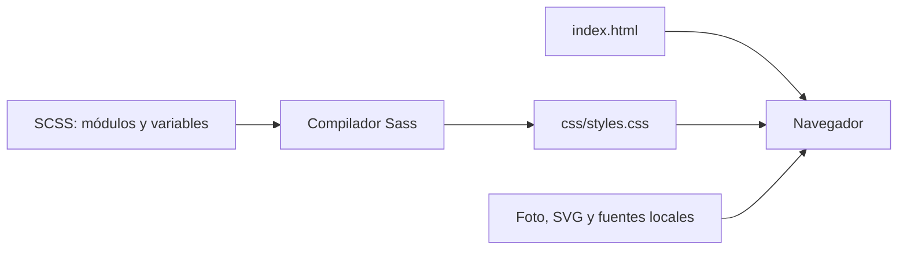

# GlowQueen — Spa & Beauty

Ejercicio de curso: reproducción estática de la página 2 del PDF en un lienzo fijo de **1920 × 1080 px**, con HTML semántico y Sass.

**Web:** <https://ale-108.github.io/SPA-BEAUTY/>


## Ejecutar y compilar

La página se abre directamente desde `index.html`: CSS compilado, fuentes e imágenes son locales. Para trabajar con servidor:

```bash
git clone https://github.com/ALE-108/SPA-BEAUTY.git
cd SPA-BEAUTY
npm ci
npm run build
npm start
```

Abrir <http://127.0.0.1:5173>. Requisitos de desarrollo: Node.js22 o posterior, npm y Python3 para el servidor estático. `npm run watch` recompila al editar Sass. Detener con Ctrl+C.

## Ajuste punto por punto

| Consigna                         | Implementación                                                                                                   |
| -------------------------------- | ---------------------------------------------------------------------------------------------------------------- |
| Boilerplate libre                | Base mínima propia.                                                                                              |
| Sass recomendado, no obligatorio | Sintaxis SCSS, variables, función de medidas y módulos con `@use`.                                               |
| Diseño estático                  | Lienzo fijo1920×1080, sin responsive ni escalado según ancho. En ventanas menores se recorre con desplazamiento. |
| Recursos de diseño               | Fotografía original del FIG adjunto; vectores del PDF. Véase `docs/RECURSOS.md`.                                 |
| Iconos SVG                       | Navegación, acciones, estadísticas y decoración vectoriales.                                                     |
| Semántica                        | header/nav/main, secciones, listas y blockquote con autor.                                                       |
| Fidelidad al PDF                 | Distribución, foto, textos, colores y superposiciones comparados a1920×1080.                                     |
| Hover obligatorio                | Cambios inmediatos de estilo, sin animaciones ni transiciones temporizadas.                                      |
| Repositorio específico           | https://github.com/ALE-108/SPA-BEAUTY                                                                            |
| Enlace público                   | GitHub Pages desde main, raíz.                                                                                   |

## Hover y alcance

- Botones principales: cambio inmediato de fondo.
- Enlaces y navegación: subrayado; la marca reduce su opacidad.
- Lupa y bolsa: cambio inmediato de color.
- Watch Video: cambio de fondo del círculo y subrayado del texto.
- Sign In: cambio de separación del subrayado.

La consigna pide un estado hover, pero no define sus colores o acabados. Las sombras y transparencias visibles en reposo reproducen el PDF: no son animaciones.

La barra de navegación y la flecha More pertenecen a la composición. **More no abre un desplegable.** Los botones reproducen controles visuales y no ejecutan reservas, cuentas, compras, búsqueda ni video. No abren avisos ni ventanas. Los enlaces internos básicos apuntan a secciones existentes. El foco de teclado utiliza el comportamiento nativo del navegador.

No hay JavaScript de producto, popovers, adaptación móvil, `@keyframes` ni reglas de `animation` o `transition`.

## Organización y Sass

```text
index.html              Estructura y contenido semántico
assets/                 Foto, SVG y fuentes locales con licencia
scss/_tokens.scss       Colores y función de medidas en píxeles
scss/_base.scss         Fuentes, reset, botones y hover
scss/_header.scss       Cabecera y navegación visual
scss/_hero.scss         Lienzo fijo, contenido y capas
scss/styles.scss        Entrada Sass
css/styles.css          CSS compilado para el navegador
docs/LIBRETO_VIDEO.md    Libreto del desarrollo
docs/RECURSOS.md         Procedencia de recursos
```



SCSS es una sintaxis de Sass. El navegador recibe el CSS generado con `npm run build`. Los comentarios explican grupos pequeños en español.

## Verificación y publicación

```bash
npm run build
npm run check:css
npm run format:check
```

`check:css` verifica que el CSS guardado coincida con Sass. GitHub Actions comprueba compilación y formato. Se comprueban en navegador el lienzo fijo, los recursos, hover y ausencia de funciones adicionales. Comparar con el PDF a1920×1080; pueden existir diferencias menores de rasterizado entre PDF y navegador.

Pages publica la raíz de main; `.nojekyll` evita procesar el proyecto como Jekyll. Editar Sass/HTML, compilar y subir también el CSS. Para deshacer cambios, usar `git revert <commit>`. No se necesitan claves ni variables de entorno.

El [libreto](docs/LIBRETO_VIDEO.md) corresponde a esta versión estática. La grabación se hará después.
