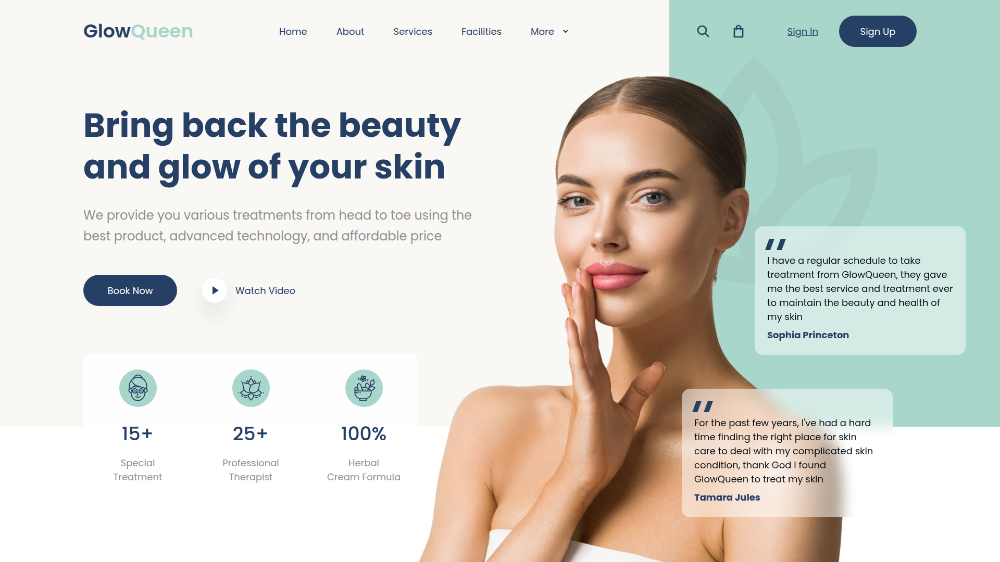
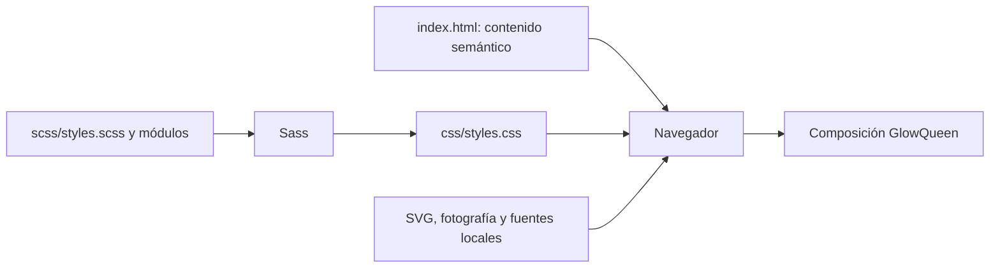

# GlowQueen — Spa & Beauty

Maquetación del header de Spa & Beauty con HTML semántico y Sass. La referencia principal es la página 2 del PDF de la consigna, con lienzo de **1920 × 1080**.



## Ejecutar

La página terminada puede abrirse directamente desde `index.html`: el CSS, las fuentes y las imágenes son locales. Para trabajar con un servidor local:

```bash
git clone https://github.com/ALE-108/SPA-BEAUTY.git
cd SPA-BEAUTY
npm ci
npm run build
npm start
```

Abrir <http://127.0.0.1:5173>. El repositorio es privado y clonar requiere acceso autorizado a GitHub. Requisitos de desarrollo: Node.js 22 o posterior, npm y Python 3 para el servidor estático. No hay dependencias de Python que instalar.

Para editar Sass con compilación automática, abrir una segunda terminal y ejecutar `npm run watch`. Detener los procesos con `Ctrl+C`.

## Organización

```text
index.html              Contenido y estructura semántica
assets/fonts/           Poppins local y licencia OFL
assets/icons/           SVG originales recuperados y decoración
assets/images/          Fotografía con transparencia
scss/_tokens.scss       Colores y escala del diseño
scss/_base.scss         Fuentes, reset, botones y accesibilidad
scss/_header.scss       Cabecera y navegación
scss/_hero.scss         Composición y superposiciones
scss/_mobile.scss       Adaptación adicional para pantallas pequeñas
scss/styles.scss        Entrada de compilación
css/styles.css          CSS compilado, incluido para abrir sin instalar nada
docs/LIBRETO_VIDEO.md    Guion narrado del desarrollo
docs/RECURSOS.md         Procedencia y límites de uso de recursos
```

## Cómo funciona



La cabecera usa Grid y Flexbox. La fotografía, la decoración y las tarjetas se anclan al contenedor con `position: absolute`. La función Sass `design()` convierte las coordenadas de referencia en unidades `cqw`, relativas al ancho del contenedor. Bajo 900 px, el contenido se apila para mantener su lectura. Esa adaptación es adicional: la consigna evalúa principalmente el escritorio.

## Interacciones y alcance

- Home, About y Services navegan a secciones existentes. More abre un menú nativo con enlaces a estadísticas y testimonios.
- Book Now, Sign In, Sign Up, Search, Shopping bag y Facilities muestran un aviso de vista previa. No hay reservas, usuarios, buscador ni compras reales.
- Watch Video informa que no hay un video disponible. No se agregó un video ajeno al material.
- Los avisos se abren con HTML `popover`, se cierran con su botón o con Escape y no necesitan JavaScript. Se requiere un navegador moderno compatible con Popover API y unidades de contenedor.
- Hay estados hover, foco visible, enlace de salto y respeto por `prefers-reduced-motion`.

## Verificación

```bash
npm run build
npm run check:css
npm run format:check
```

`check:css` falla si recompilar Sass cambia el CSS versionado. GitHub Actions ejecuta estas comprobaciones con cada push y pull request. El workflow verifica el proyecto; no despliega una web.

Se revisó la página en Chromium a 1920, 1440, 900 y 390 px, incluyendo recursos, navegación interna, menú More, avisos, cierre con Escape y salto de teclado. Las capturas de escritorio y móvil están en `docs/images/`. Las capturas reflejan la comprobación realizada y no sustituyen una prueba en otros navegadores.

## Publicación y mantenimiento

El repositorio permanece **privado** por decisión del propietario. No se ha habilitado GitHub Pages ni un sitio público. La exigencia académica de enlace público queda aplazada hasta una nueva instrucción del propietario.

Los cambios se hacen en `scss/`; después se compila y se confirma también `css/styles.css`. Para deshacer un cambio publicado, usar `git revert <commit>` y volver a compilar. Mantener el lockfile y usar `npm ci` para repetir la instalación. No se necesitan claves ni variables de entorno.

El [libreto de video](docs/LIBRETO_VIDEO.md) explica el desarrollo paso a paso. La grabación se hará en una etapa posterior.
